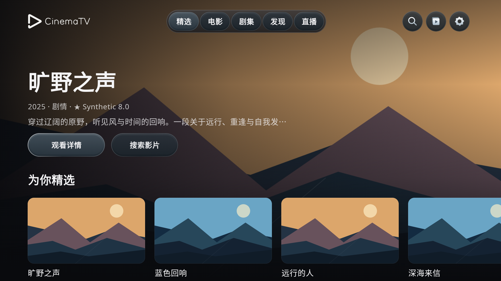
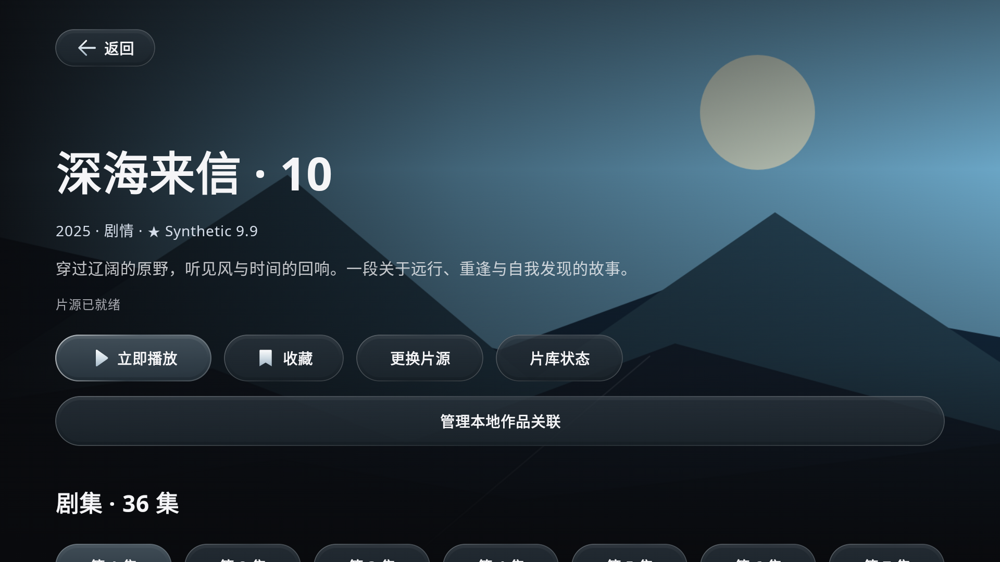
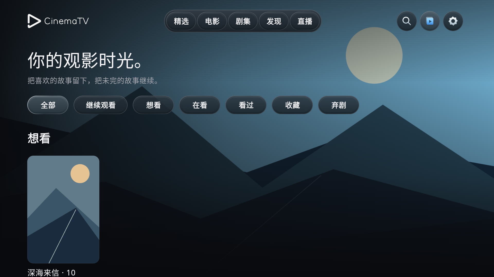
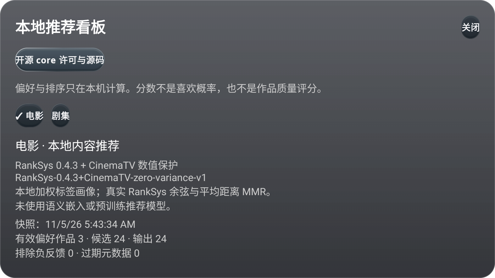
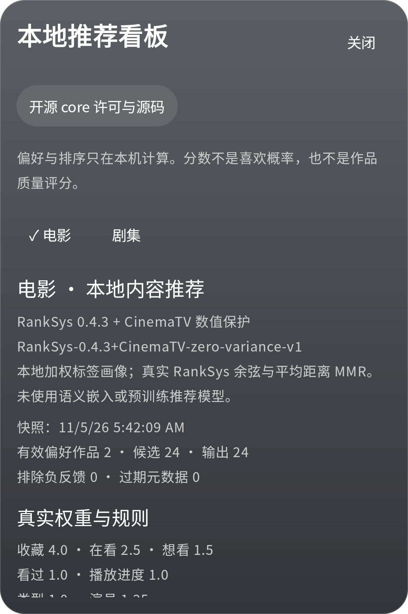

<div align="center">


# CinemaTV

**为遥控器与触屏分别设计的 Android 影视客户端**

Android TV · Google TV · Android 手机

Hybrid TV presentation, native playback and a separate touch interface.

[](docs/INSTALL.md)
[](https://github.com/blackkcold/CinemaTV/releases)
[](https://github.com/blackkcold/CinemaTV/actions/workflows/android.yml)
[](LICENSE)

[下载 APK](https://github.com/blackkcold/CinemaTV/releases) · [安装指南](docs/INSTALL.md) · [使用与隐私](docs/LOCAL_LIBRARY.md) · [反馈问题](https://github.com/blackkcold/CinemaTV/issues)

</div>

CinemaTV 连接你自建的 [LibreTV](https://github.com/LibreSpark/LibreTV)，把浏览、搜索、选集、播放和本地片库放在同一个应用里。混合架构 Dev 使用本地 React/CSS 呈现电视浏览界面，Kotlin、Jetpack Compose 和 Media3 继续负责原生播放、数据与手机界面。

**已发布 Stable：[v0.8.0](https://github.com/blackkcold/CinemaTV/releases/tag/v0.8.0)；已发布 Dev：[v0.8.0-dev.2](https://github.com/blackkcold/CinemaTV/releases/tag/v0.8.0-dev.2)。** 本分支在开发新的混合电视界面，进度和验收范围见 [Hybrid TV](docs/HYBRID_TV.md)。下方主画廊仍保留有明确来源的 v0.7.0-preview 原生界面截图，不将它们标为新版混合界面。

应用不附带公共片源、账号或影视内容。使用前需要配置自己的服务和有权访问的内容来源。本项目与 LibreTV、DpadTV 及下列第三方服务均无隶属关系。

## 界面

<table>
<tr>
<td width="50%"><br><sub>电视首页</sub></td>
<td width="50%"><br><sub>详情与选集</sub></td>
</tr>
<tr>
<td><br><sub>本地片库</sub></td>
<td><br><sub>本地推荐看板</sub></td>
</tr>
</table>

以上为 **v0.7.0-preview** 在 Android 模拟器中实际运行的界面，非设计稿。展示使用虚构片名、原创测试画面和合成媒体，不代表内置影视资源。拍摄版本、运行环境与原始证据见 [截图说明](docs/images/README.md)。

<details>
<summary>查看手机推荐看板</summary>



</details>

## 可以做什么

### 浏览与搜索

- 电视使用全屏场景、横向内容轨道和独立电影/剧集布局；方向键移动后保留焦点与滚动位置。
- 搜索先呈现本地记录，再补充已配置目录和 LibreTV 片源；支持来源提供的别名、演员、类型和年份信息。
- 有完整数据时可按类型、年份、评分筛选。缺失字段保持未知，评分保留真实来源。
- 横版图片进行保守匹配与尺寸检查；没有合适图片时使用原创背景。

### 片库与续播

- 收藏、想看、在看、看过、弃剧和逐集进度保存在本机。收藏与观看状态可以同时存在。
- 按已知作品、季和来源浏览详情；支持手动关联未识别条目，并提供冲突检查、取消关联和一步撤销。
- 播放进度遵循来源与剧集身份。身份不确定时保留记录，不把进度猜测性地转到另一集或另一来源。

### 播放与直播

- Media3 播放、选集、来源切换、倍速及可用音轨/字幕选择，支持后台暂停与逐集续播。
- 手机使用独立触控播放器，适配横竖屏和旋转时的播放连续性。
- M3U 订阅、频道分组，以及 XMLTV 当前、接续与后续节目单。

### 本地推荐

- 根据本机收藏、观看状态与进度，为已配置的目录候选排序。没有偏好记录时保留来源顺序，负反馈会排除匹配作品。
- 设置中的「本地推荐看板」展示实际引擎、权重、偏好标签和排序依据。使用 RankSys 余弦相似度与 MMR，并加入 CinemaTV 数值保护。
- 偏好与排序留在设备上，不使用推荐网络服务。搜索、图片和播放仍需要相应网络连接。

推荐分数不是喜欢概率，也不是作品评分。更多实现与限制见 [推荐说明](docs/RANKSYS_INTEGRATION.md)。

### 适配与显示

- 电视遥控器与手机触屏分别设计，提供分层玻璃控件、减少动态效果和性能降级。
- 原生界面离线打包 Noto 字体，按内容语言与地区选择中日韩字形，不转换简繁内容；混合电视界面复用拉丁字体，中日韩文字使用设备的地区字体。
- 原创 A1 品牌与静态启动图标；应用内简短品牌动态不阻塞操作。

## 混合架构 Dev

电视浏览层采用 APK 内的 React/TypeScript/CSS，包含首页、发现、电影、剧集、搜索、详情、资料库、直播与设置入口。视觉以全屏场景、悬浮玻璃导航、清晰焦点和有层次的内容轨道为基础。

- 安装下限保持 API26；混合界面检查 API29+、WebView Chromium111+ 和受限消息接口。旧系统、缺失内核或渲染器故障进入原生兼容界面。
- HTML、CSS 和 JS 随 APK 打包；播放仍由原生 Media3 处理，收藏与逐集进度继续使用同一个 Room 片库。
- 玻璃材质、焦点动效、减少动态与基础效果分档独立处理；不让 CSS 模糊采样原生视频 Surface。
- 原生兼容界面与手机的材质边界仍见 [玻璃实现](docs/GLASS_PRODUCTION.md)、[动效实现](docs/MOTION_PRODUCTION.md)。浏览器与模拟器验收不代表真实电视帧率认证。

## 安装与首次使用

最低要求为 **Android 8.0 / API 26**。同一应用支持电视与手机，包名为 `dev.cinematv`。

1. 从 [Releases](https://github.com/blackkcold/CinemaTV/releases) 下载 APK，并阅读该版本的签名与升级说明。
2. 安装后打开「设置 → 连接与账户」，填写自建 LibreTV 地址，按需登录。
3. 使用服务端已配置的来源，或添加自己有权访问的 Apple CMS JSON API / M3U 订阅。
4. 搜索一部作品，打开详情选择来源和剧集。收藏与观看进度会进入本地片库。

例如，服务地址可以是 `https://libretv.example.com`。这是占位示例，需要替换为自己的地址。公网连接建议使用 HTTPS。

可选的 [TV BFF](backend/tv-bff/README.md) 提供授权目录与 TMDB 元数据匹配。没有配置目录时，首页可使用本地记录；首次使用没有记录时，可先通过 LibreTV 搜索添加内容。

**升级提醒：** 现有调试预览包的签名可能不同。出现签名冲突时不要直接卸载；卸载会删除本地设置、片库和观看进度，目前没有通用导出恢复或跨设备同步。

完整配置、遥控器操作和设备测试范围见 [安装指南](docs/INSTALL.md)。

**更新通道：** Stable 与 Dev 沿用同一个包名和固定签名，版本码全局递增。Dev 的豆瓣个人账户实验默认关闭，其验收与混合浏览层分开记录。手动下载版本和自动更新清单分别发布，是否可安装以实际 Release 和签名说明为准，详见 [更新通道](docs/UPDATE_CHANNELS.md)。

## 数据与隐私

- 不附带服务器凭据、公共片源、豆瓣目录数据或商业影视海报。
- 本地片库、设置和播放链接不进入 Android 云备份或设备迁移；不上传偏好与推荐历史。
- 播放链接不会发送给 TMDB。可选元数据服务仍须由运营者遵守其使用条件。
- 豆瓣获取默认关闭，需要适用授权与获准端点验证；不能把配置声明当成授权证明。

[本地数据说明](docs/LOCAL_LIBRARY.md) · [来源与授权边界](docs/DOUBAN_ACQUISITION.md)

## 开发

环境：JDK 17、Gradle 8.13、Android SDK 36、Build Tools 36.0.0、Node 22.12+。测试媒体已随源码提供，普通构建无需 FFmpeg。Gradle 会按锁文件安装并编译 TV 前端；Node 仅用于构建，不打包进 APK。

```bash
bash scripts/generate-test-media.sh
gradle --no-daemon :app:testDebugUnitTest :app:assembleDebug :app:assembleDebugAndroidTest :app:lintDebug
npm --prefix backend/tv-bff test
```

调试 APK 输出到 `app/build/outputs/apk/debug/app-debug.apk`。

单独迭代电视界面：

```bash
cd frontend/tv-web
npm ci
npm run dev
# 另一个终端：npm run build && npm run verify && npm test
```

浏览器预览使用开发专用合成资料；生产构建会排除这些数据。网页预览不会播放真实视频或写入 Android 片库。

- [架构](docs/ARCHITECTURE.md)：共享数据与播放逻辑，独立 TV / 手机界面。
- [构建与测试](https://github.com/blackkcold/CinemaTV/actions/workflows/android.yml)：编译、Lint、单元与协议测试。
- [验收与发布边界](docs/RELEASE_CHECKLIST.md)：模拟器 UI、真实播放协议、硬件覆盖与签名要求。

欢迎提交可复现的问题或改进建议。反馈时请附上版本、设备型号、Android 版本与操作步骤，并移除密码、令牌、私有地址和播放链接。

## 当前边界

预览版的模拟器测试不能替代实体电视认证。低内存盒子、长时间播放、HDR/编解码器覆盖与硬件图形性能仍需真机验证。当前不提供跨设备同步、扫码配对或额外播放内核。

功能与验收范围集中维护在本文及对应文档中；逐版变更请查看 [发布记录](https://github.com/blackkcold/CinemaTV/releases)。

## 许可与致谢

CinemaTV 原创代码和测试画面采用 [MIT License](LICENSE)。没有复制 DpadTV、FongMi 或 LibreTV 的实现代码，原创品牌素材位于 [design/branding](design/branding/)。

- [LibreTV](https://github.com/LibreSpark/LibreTV)：连接的上游服务。
- [AndroidX Media3](https://github.com/androidx/media)、Jetpack Compose：播放与原生界面。
- React / React DOM / Scheduler：MIT；运行时许可随 TV Web 资源一同打包。
- RankSys：MPL-2.0；fastutil / jOOL：Apache-2.0，保留对应版本的附加声明。APK 提供完整许可及匹配版本的 RankSys 源码包，详见 [第三方推荐组件](docs/RANKSYS_INTEGRATION.md)。
- 主分支的 AndroidLiquidGlass / Backdrop 复用部分采用 Apache-2.0，保留 [许可证](backdrop/LICENSE)、[上游与修改声明](backdrop/NOTICE.md)，不归入 CinemaTV 原创 MIT 代码。
- Noto Sans / Noto Sans CJK：SIL Open Font License，详见 [字体说明](docs/NOTO_TYPOGRAPHY.md)。
- TMDB：可选元数据来源；官方品牌素材与使用说明见 [第三方资产](docs/THIRD_PARTY_ASSETS.md)。

This product uses the TMDB API but is not endorsed or certified by TMDB.
