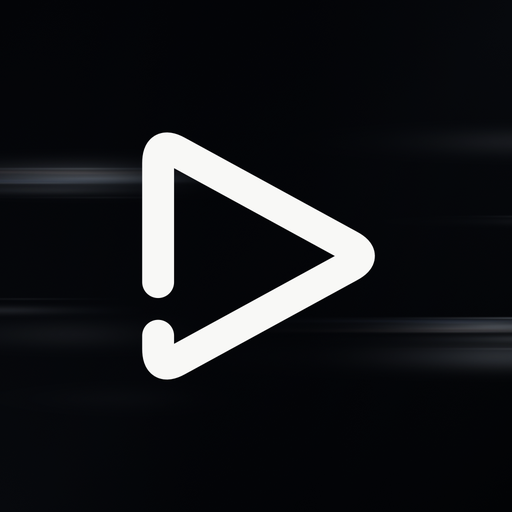
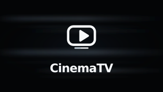

# CinemaTV

A native Android TV / Google TV and Android phone client for a self-hosted LibreTV instance.
Kotlin, Jetpack Compose for TV and Media3; separate TV and touch layouts.

**v0.5.0 Preview: local library and personalized discovery.** Releases are debug-signed
previews. Physical TV certification and production signing remain tracked in
[Release Gate #1](https://github.com/blackkcold/CinemaTV/issues/1).

[Download releases](https://github.com/blackkcold/CinemaTV/releases) ·
[Build and QA](https://github.com/blackkcold/CinemaTV/actions/workflows/android.yml) ·
[中文安装指南](docs/INSTALL.md) · [UI rebuild decisions](docs/UI_REDESIGN.md)

## Features

| Area | Behavior |
|---|---|
| TV browsing | Full-screen decoded scene, floating navigation, responsive hero, landscape rails and center-focused discovery |
| Movies / series | Distinct poster-wall and landscape-card layouts; filters use available category/year/rating data |
| Focus | Route/rail/title identity, scroll restoration, controlled horizontal traversal, dialog and player return targets |
| Artwork | Conservative title/year matching, bounded cache/prefetch, validated landscape dimensions, original fallback |
| Glass / motion | Basic, still-image backdrop and opt-in enhanced highlight modes; low-memory/API fallback and reduced motion |
| Search / library | Room-backed works/seasons/episodes/sources; local, catalog and NDJSON stages; title/alias/actor search and provenance-aware filters |
| Recommendations | Local explicit favorites/status/progress signals, explainable ranking, negative feedback and cold-start catalog order |
| Playback | Media3, episode resume and measured duration, floating TV controls, track/speed panels, background pause |
| Live | M3U subscriptions, channel groups, XMLTV current/next and scrollable future guide |
| Phone | Five tabs, separate touch screens and fitted portrait/landscape playback with rotation continuity |
| Service | Direct LibreTV adapter; optional licensed-catalog/TMDB BFF and separately gated Douban Top 250 acquisition with explicit source, expiry and snapshot state |

The APK contains no public content feeds, credentials, catalog dataset or copyrighted posters. It includes an approved [TMDB brand asset](docs/THIRD_PARTY_ASSETS.md) under TMDB attribution rules.
UI QA uses fictional titles, original vector artwork and a synthetic H.264/AAC
clip confined to the instrumentation APK.

## Build and test

JDK 17, Gradle 8.13, Android SDK 36 / build tools 36.0.0.

```bash
gradle --no-daemon :app:testDebugUnitTest :app:assembleDebug :app:assembleDebugAndroidTest :app:lintDebug
npm --prefix backend/tv-bff test
```

APK: `app/build/outputs/apk/debug/app-debug.apk`.

The Actions build validates the APK archive and signature. UI QA covers a portrait
phone (API 30) plus 1920×1080 and 3840×2160 TV UI viewports (API 33). `[ui-qa]`
commits run the full instrumentation matrix; `[preview-release]` additionally
publishes only after build and all UI jobs pass **at that commit**. Screenshots,
JUnit results, reviewed screenshot comparisons and informational emulator frame
metrics accompany the preview. Missing evidence or failed comparisons block publication.

## Setup

1. Install on Android 8.0 / API 26 or later.
2. Open Settings and connect your self-hosted LibreTV instance; sign in when required.
3. Use the server's configured sources or add your authorized CMS / M3U sources.
4. Optionally configure a TV BFF with an operator-managed TMDB token for matched landscape art and an authorized metadata catalog. Douban acquisition has a separate [permission and activation gate](docs/DOUBAN_ACQUISITION.md).

[Full installation and device QA guide](docs/INSTALL.md).

## Architecture

- [`ui/tv/`](app/src/main/java/dev/cinematv/ui/tv): design tokens, scene/glass/cards,
  focus registry, floating navigation and independent TV pages.
- [`ui/mobile/`](app/src/main/java/dev/cinematv/ui/mobile): Material 3 touch UI.
- `CinemaViewModel`: shared presentation, navigation and local-library state.
- `data/`: sole LibreTV protocol decoding and persistence boundary.
- `playback/` and `ui/TvPlayerPage.kt`: player ownership, lifecycle and TV overlay.
- [`backend/tv-bff/`](backend/tv-bff): optional dependency-free Node metadata adapter.

[Architecture](docs/ARCHITECTURE.md) · [Engineering constraints](AGENTS.md).

## Current limits

The preview is not a physical-device or production-signing certification. True
framebuffer optical refraction, four-hour playback/codec/HDR hardware coverage,
cross-device sync, QR pairing and additional playback engines remain outside this
preview. Legacy preferences import into Room is implemented; future Room schema
versions still require explicit migrations. Still-image glass never samples a video Surface.
Douban acquisition is fixture-tested and disabled by default; applicable written
permission and permitted live endpoint validation have not been established.

## Original branding

Editable SVGs live in [`design/branding/`](design/branding/). The black motion-blur
app icon, white player glyph and centered 320×180 TV banner remain unchanged.

| App icon | TV banner |
|---|---|
|  |  |

## Licensing

CinemaTV-authored code and test art use the [MIT License](LICENSE). No DpadTV,
FongMi or LibreTV implementation source is copied. Third-party libraries and
metadata services retain their own licenses and attribution conditions.

This product may use the TMDB API through an independently configured BFF but
is not endorsed or certified by TMDB. No API key is bundled. Public service
connections should use HTTPS.

See [local library and privacy](docs/LOCAL_LIBRARY.md) and [v0.5.0 preview notes](docs/releases/v0.5.0-preview.md) for migration, expiry, validation and release boundaries.
